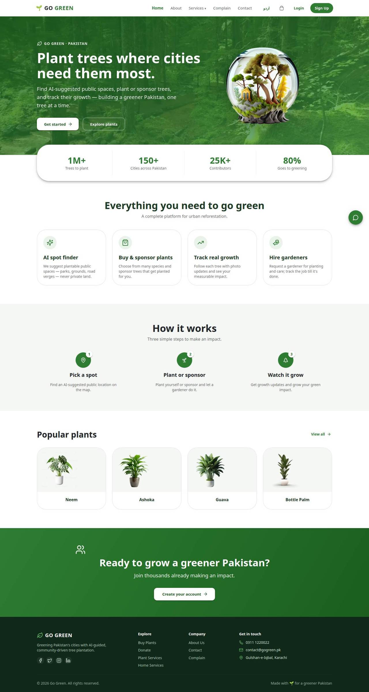
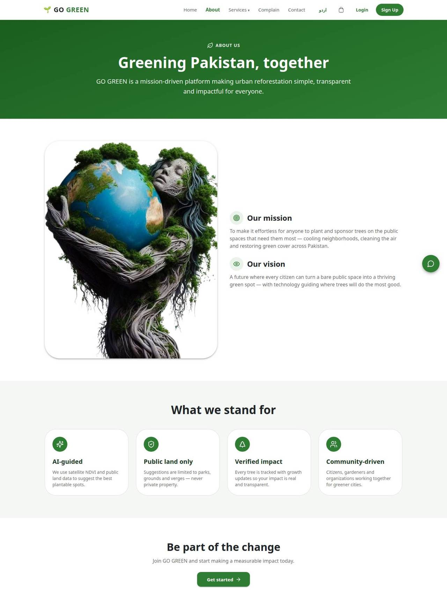
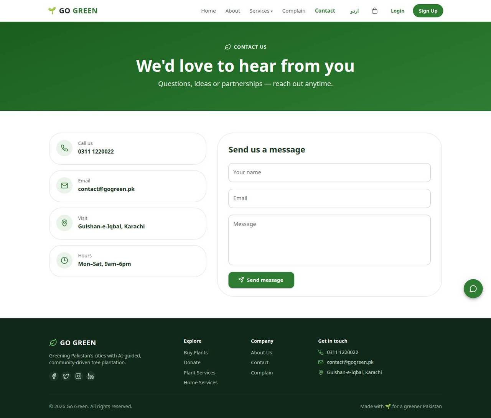
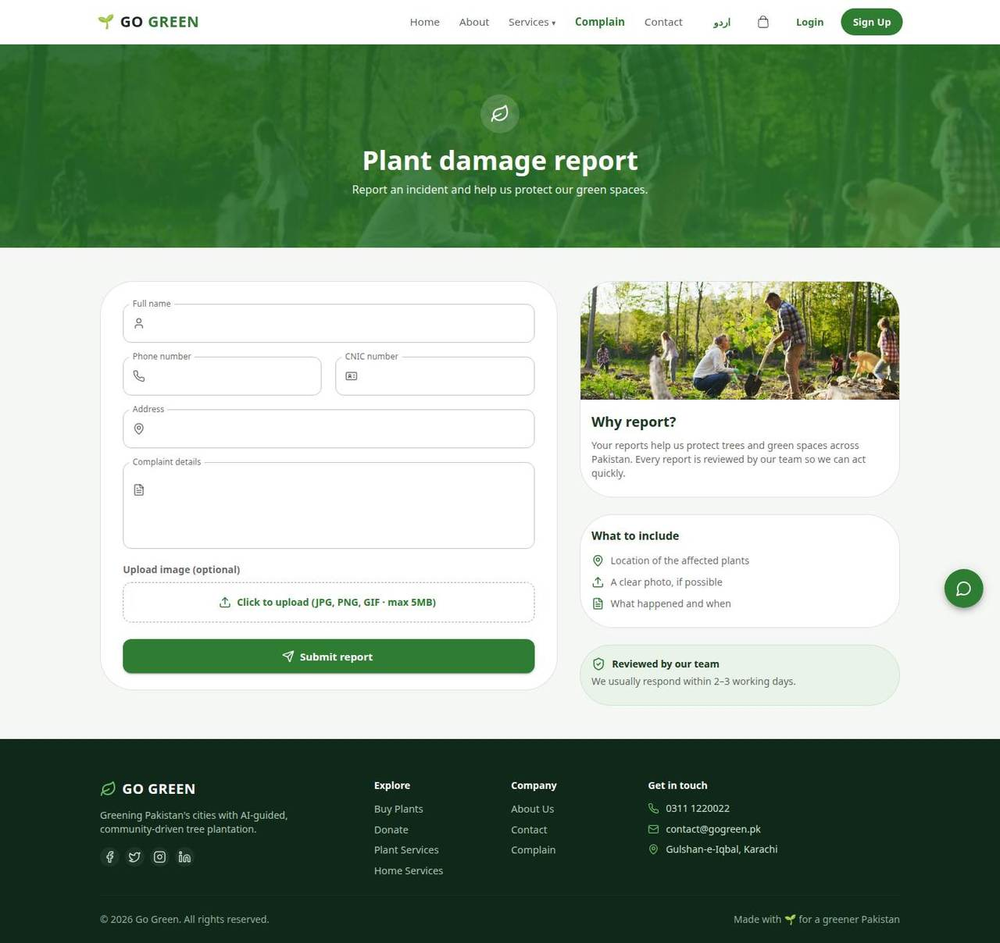
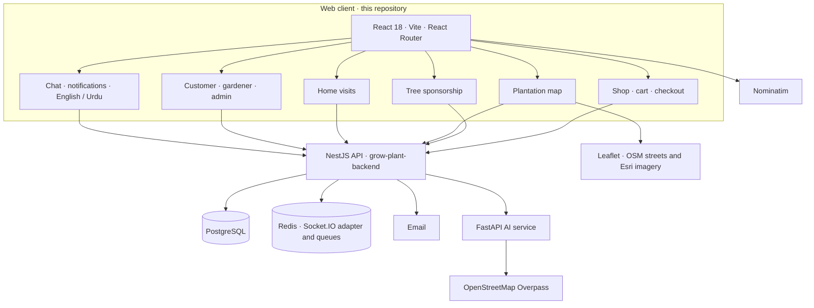

# Go Green Pakistan

**Plant E-commerce & Tree Sponsorship**

A final-year project at FAST-NUCES. Go Green Pakistan is a web platform for buying plants, sponsoring trees on public land, and booking gardeners. Shoppers browse a live catalog, pledge a number of trees, or pin a plantation on the map. Gardeners pick up assigned jobs, and an admin desk keeps plants, payments, and approvals in one place.

This repository is the web client. Accounts, orders, chat, and the plantation assistant are served by the [NestJS API](https://github.com/maarijwaseem2/grow-plant-backend).

**Live demo:** [https://go-green-pakistan.vercel.app](https://go-green-pakistan.vercel.app)

## Screenshots

Captured from the live site.

### Home

The public landing page: hero, how the platform is framed, and featured species.

### About

Mission, vision, and the public-land planting story.

### Contact

A public contact form that posts to the API, plus the studio details shown on the page.

### Complaints

A public complaint form with an optional photo.

## Features

Everything below is implemented in this client and the linked API.

### Shop and checkout

- The shop loads plants from the API and filters by name, category, and price. Categories cover indoor and outdoor plants, fruit, flowers, vegetables, herbs, seeds, soil, fertilizers, pots, tools, pest control, and watering.
- Signed-in customers add items to a cart, enter a billing address, and place an order.
- Checkout offers cash on delivery, or a manual EasyPaisa or JazzCash transfer. The transfer reference is stored for an admin to approve or reject.
- Removing a line from the cart calls the API to release that quantity.

### Tree sponsorship

- Signed-in customers choose how many trees to sponsor. The page prices each tree at Rs 100 and records the pledge with the API.

### Plantation booking

- A Leaflet map opens on Karachi, with OpenStreetMap streets and Esri satellite imagery.
- Customers search for a place, use the browser’s location, or ask the assistant for public planting spots near the map center. Suggestions come from OpenStreetMap parks, grounds, and recreation land. Private and residential land is excluded by the AI service.
- Each suggestion can request a greenness reading. That reading estimates visible green cover from satellite imagery.
- The booking carries selected plants, an optional care plan (Basic or Advanced, for a chosen number of months), and an optional photo of the site.

### Home visits

- Customers pick catalog items, set an area and address (typed or detected), and request a gardener visit. A gardener fee is added to the plant total.

### Tracking, chat, and notifications

- “My services” lists plantation jobs, home visits, and shop orders, with a status path of Requested, Assigned, In Progress, and Completed.
- Once a gardener is assigned, the customer can message them. Chat is delivered over Socket.IO, with an unread count in the header.
- Signed-in users get an in-app notification list, updated live over the same socket connection and refreshed on a timer.

### Accounts and roles

- New accounts register as a customer or a gardener, with a Pakistani mobile number, province, and city. The city and province can be filled from the browser’s location.
- The interface switches between English and Urdu. Urdu turns the page direction to right-to-left for the translated navigation and hero.
- Gardeners keep a profile (photo, CNIC, phone, address, experience, services, and bike details) and update job status from their dashboard. The dashboard tells them they stay off the public gardener list until an admin approves them.
- The admin desk shows plant, order, user, and pending-job counts. From there an admin can add, edit, and delete plants, assign gardeners to plantation and home jobs, decide manual payments, mark contact messages handled, and approve gardeners.

### Assistant

- A floating Go Green Assistant on every page sends the conversation to the API’s chat endpoint.
- On the shop, a recommender asks for sunlight and space, then offers matching plants that can be added to the cart.

### Public pages

- Home, about, contact, and complaints are open without an account. Contact messages and complaints (with an optional image) are stored by the API.

## Architecture

The API modules behind those calls include auth, users, plants, orders, payments, donations, plantation services, home services, complaints, contact, notifications, chat, and the AI gateway. The gateway proxies spot suggestions, the greenness check, chat, and plant recommendations. A plant-photo check also exists on that gateway.

## Tech stack

| Layer | Choices in this project |
| --- | --- |
| Web client | React 18, Vite 5, React Router 6, MUI, Tailwind CSS, Axios |
| Maps | Leaflet, react-leaflet, OpenStreetMap, Esri World Imagery, Nominatim |
| Live updates | Socket.IO client |
| Auth on the client | JWT via `jose` |
| API | NestJS, TypeORM, Passport JWT, class-validator |
| Data | PostgreSQL, Redis, BullMQ |
| Assistant | FastAPI service for public-land spots and greenness; chat and recommendations through the NestJS AI gateway |
| Hosting | Web client on Vercel · [go-green-pakistan.vercel.app](https://go-green-pakistan.vercel.app) |

## Roadmap

- Connect the API’s plant-photo check to the booking flow. The gateway already accepts a photo; this client does not call it yet.
- Publish live plantation totals on the home page. The figures there today are written into the page.
- Add a per-tree photo journal. Customers can already follow a job from request to completion, and a booking can include one site photo.
- Turn on browser push. The in-app notification center is live; the Firebase web-push configuration in this repo is still a placeholder.
- Add spectral greenness scoring in the AI service. The current spot check estimates visible green cover from satellite imagery.

## Author

**Syed Abdul Maarij** — final-year project, FAST-NUCES.

- GitHub: [maarijwaseem2](https://github.com/maarijwaseem2)
- Portfolio: [own-showcase.vercel.app](https://own-showcase.vercel.app)
- API: [grow-plant-backend](https://github.com/maarijwaseem2/grow-plant-backend)
